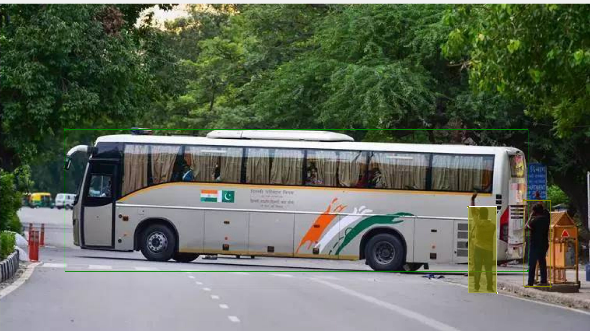
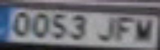
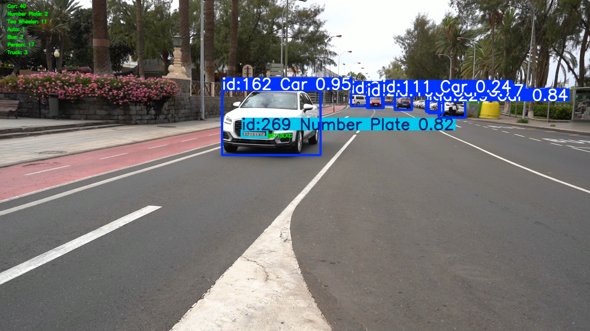
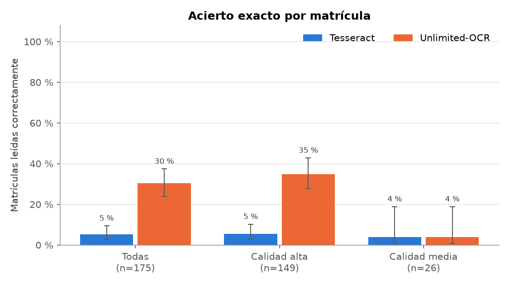
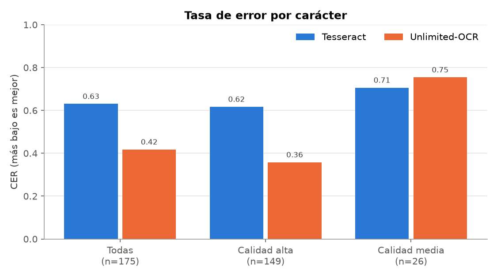
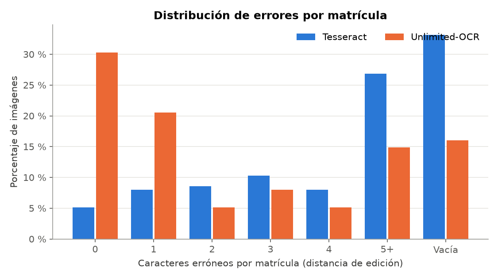
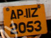
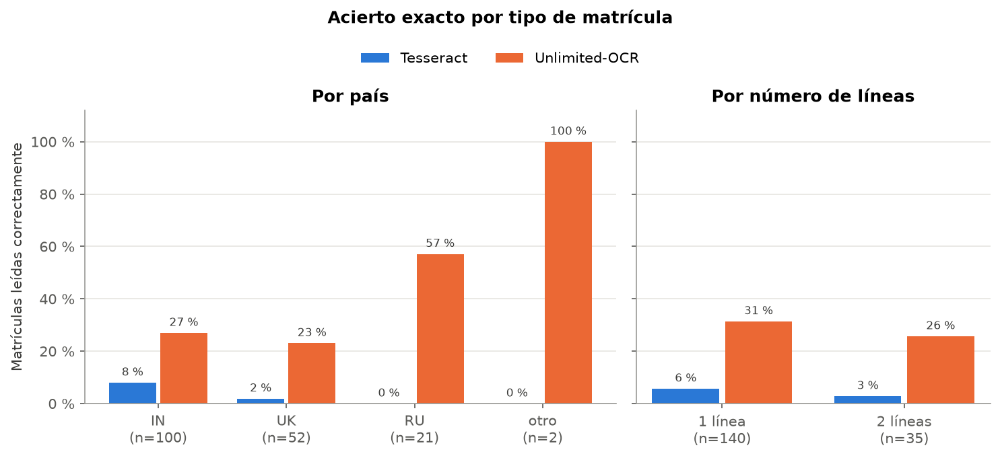
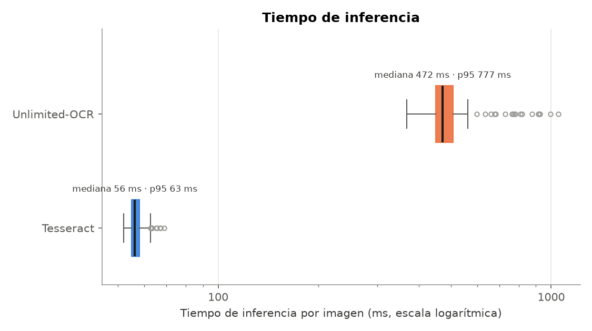
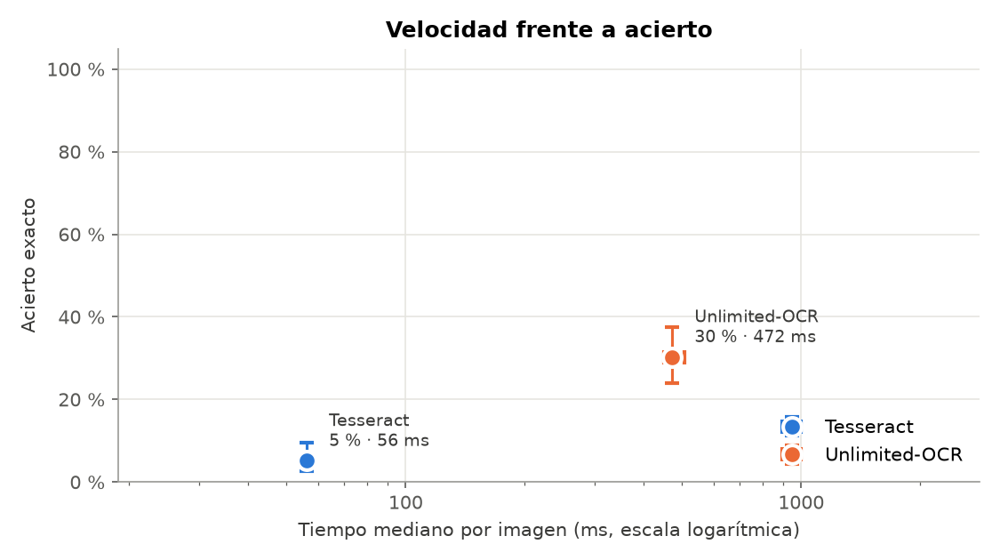

# Visión por Computador - Práctica 4

## Entrenamiento

Esta práctica ha consistido en realizar un prototipo, que procese vídeo para la detección y seguimiento de vehículos y personas, además deberá aplicar reconocimiento de caracteres sobre las matrículas visibles.

Para ello se ha utilizado como base el dataset de este enlace[^1], que incluye la mayoría de las clases requeridas, faltando las personas. Las anotaciones se encuentran en el formato de entrenamiento de YOLO, para modificarlas las convertimos al formato json de *labelme* y automatizamos la mayor parte de la anotación de las personas utilizando la detección del modelo *yolo11n.pt*, revisando el resultado con la herramienta *labelme*. El código utilizado para esto está en [generardataset.ipynb](generardataset.ipynb).



Una vez procesado, convertimos las anotaciones al formato y estructura de carpetas de YOLO utilizando la herramienta *C:\Users\Usuario\VC_RES\VC_P4*.

```Anaconda Prompt
pip install labelme2yolo
labelme2yolo --json_dir res --val_size 0.16 --test_size 0.2
```

Utilizamos el dataset resultante para entrenar durante 80 ciclos

```Anaconda Prompt
yolo detect train model=yolo11n.pt data=dataset.yml imgsz=640 batch=4 device=0 epochs=80
```

## Procesamiento

El resultado del entrenamiento se ha utilizado para procesar el video [C0142.MP4](https://alumnosulpgc-my.sharepoint.com/personal/mcastrillon_iusiani_ulpgc_es/_layouts/15/stream.aspx?id=%2Fpersonal%2Fmcastrillon%5Fiusiani%5Fulpgc%5Fes%2FDocuments%2FRecordings%2FC0142%2EMP4&ga=1&referrer=StreamWebApp%2EWeb&referrerScenario=AddressBarCopied%2Eview%2Eb7b0483f%2D963e%2D474e%2D820b%2D16af9eae7f4d). La detección del texto en las matrículas se ha realizado empleando *pytesseract*, pre-procesando las imágenes mediante un umbralizado para eliminar ruido y facilitar la extracción del texto y descartando caracteres no alfanuméricos del resultado. Pese a estos esfuerzos los resultados obtenidos no son muy buenos y aunque en ocasiones se aproxima al texto de la matrícula, con más frecuencia difiere completamente.




El resultado del procesamiento genera un video con las siguientes características:
- detecta y sigue las personas y vehículos presentes
- detecta y lee las matrículas de los vehículos presentes
- cuenta el total de cada clase



Adicionalmente, genera un archivo csv con los siguientes campos:

```CSV
fotograma, tipo_objeto, confianza, identificador_tracking, x1, y1, x2, y2, matrícula_en_su_caso, confianza, mx1,my1,mx2,my2, texto_matricula
```


## Comparativa de OCRs

Para la comparativa, los OCRs escogidos fueron Tesseract y Unlimited-COR de Baidu.

Para facilitar la tarea, se creo un nuevo dataset con los recortes de las matriculas, haciendo una selección de aquellas que resultaran legibles y anotando su texto en un fichero CSV. Este proceso fue automatizado por un modelo de IA, con el resultado revisado manualmente.

Los datasets fueron procesados utilizando el fichero comparativa_ocr.py. Este fichero procesa las imagenes de las matriculas y genera dos ficheros CSV: resultados.csv y resume.csv.

El fichero resultados.csv incluye la siguiente información:
- modelo: Modelo que realizo la predicción (Tesseract o Unlimited-COR)
- file: Imágen de la matricula
- referencia: Matricula real
- predicción: Predicción realizada por el modelo con post-procesamiento
- salida_cruda: Predicción realizada por el modelo sin post-procesamiento
- acierto_exacto: Si arcerto on exactamente (1 es acierto, 0 es fallo)
- distancia_edicion: La distancia de Levenshtein entre predicción y referencia: el número mínimo de caracteres que hay que insertar, borrar o cambiar para pasar de una a otra.
- cer: Character Error Rate o tasa de error por carácter. Calculado como distancia de Levenshtein / longitud de la referencia.
- salida_vacia: Si la predicción tras el postprocesado quedo vacia (1 es vacia, 0 lo contrario).
- t_inferencia_ms: Lo que tardó el modelo en realizar la predicción.
- t_preproceso_ms: Lo que tardó el preprocesamiento de la imagen.
- country: País al que pertenece la mátricula.
- lines: Nº de lineas de la mátricula
- quality: Calidad de la imagen de la matricula (alta o media).

El fichero resumen.csv incluye la siguiente información:
- modelo: Modelo que realizo la predicción (Tesseract o Unlimited-COR)
- subconjunto: Subconjunto en base a la calidad de las imagenes (Todas, solo alta o solo media)
- n_imagenes: Nº de imagenes del subconjunto.
- exact_match: Proporción de matrículas leídas enteras y exactamente bien.
- ic95_exact_match: Intervalo de confianza del 95% para los aciertos exactos. Calculado como 1,96 · √( p·(1−p) / n )
- cer_global: La suma de las distancias de edición de todas las imágenes, dividida entre el total de caracteres de las referencias.
- cer_medio: La media del CER de cada imagen por separado.
- salidas_vacias: Proporción de imágenes en las que el modelo no devolvió ningún carácter válido después del postprocesado.
- t_media_ms: La media de los tiempos, en milisegundos.
- t_mediana_ms: La mediana de los tiempos, en milisegundos.
- t_p95_ms: El percentil 95 de los tiempos.
- t_std_ms: La desviación típica de los tiempos.
- t_min_ms: El tiempo más rápido.
- t_max_ms: El tiempo más lento.
- imagenes_por_s: Imágenes procesadas por segundo.
- t_carga_modelo_s: Segundos que tarda en cargarse el modelo, sin contar el warm-up.
- mem_gpu_pico_mb: La memoria de GPU máxima que ha ocupado PyTorch durante la ejecución, en MB.

El pre-procesado realizado difirio al realizado durante el procesamiento del video. En este caso se aplico: redimensionamiento, tranformación a escala de grises, umbralización con Otsu, inversión condicional de la polaridad de la imagen para asegurar texto negro sobre fondo blando y añadido de borde blanco para facilitar el reconocimiento de caracteres cerca de los bordes.

La configuración de Tesseract también difirio, se utilizo con el flag --psm 6 el lugar de --psm 11 y un flag para aplicar una lista blanca de caracteres.

Para la configuración de Unlimited-COR se siguieron las recomendaciones del README[^2]. Se into experimentar con el prompt, con "<image>car plate parsing." en lugar de "<image>document parsing.", pero los resultaros fueron inferiores. El nº máximo de tokens del resultado se limito a 128.

### Resumen de los resultados

| Modelo | Acierto exacto (IC 95 %) | CER | Salidas vacías | Latencia mediana | Latencia p95 | Imágenes/s | Carga modelo | Memoria GPU pico |
|---|---|---|---|---|---|---|---|---|
| Tesseract | 5.1 % (2.7–9.5) | 0.631 | 33.1 % | 56.2 ms | 62.6 ms | 17.6 | 0.0 s | – |
| Unlimited-OCR | 30.3 % (24.0–37.5) | 0.418 | 16.0 % | 472.3 ms | 776.9 ms | 2.0 | 6.0 s | 6.8 GB |

### Tasa de acierto y Tasa de error por carácter (CER)





Como se puede observar Unlimite-OCR proporciona mejores resultados en porcentaje de aciertos completos y menos fallos en el reconocimiento de los caracteres. Cabe mencionar que esta mejora se centra en las imagenes de alta calidad, los resultados en imagenes de calidad media son similares.

### Distribución de errores por matrícula



Como se puede se puede Tesseract tiende a interpretar muchos más caracteres erroneamente, e incluso en muchos casos da respuestas vacias. Unlimite-OCR suele equivocarse en 1, 2 o 3 caracteres. La excepción de 5+ caracteres suele ser resultado de outputs extraños, como en la siguiente matricula:



Que saco: BEGINARRAYLTEXTAP12THEREFORE053ENDARRAY

### Acierto por tipo de matrícula



### Tiempo de inferencia por imagen



### Compromiso velocidad / acierto



## Autor
Javier A. Alfonso Quintana


## Fuentes
[^1]: https://datasetninja.com/traffic-vehicles-object-detection
[^2]: https://github.com/baidu/Unlimited-OCR/tree/UnlimitedOCR1.0